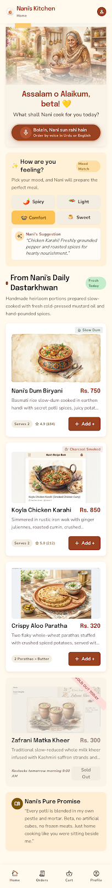
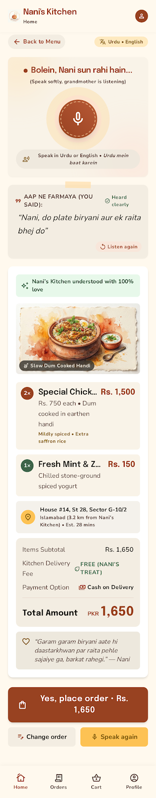
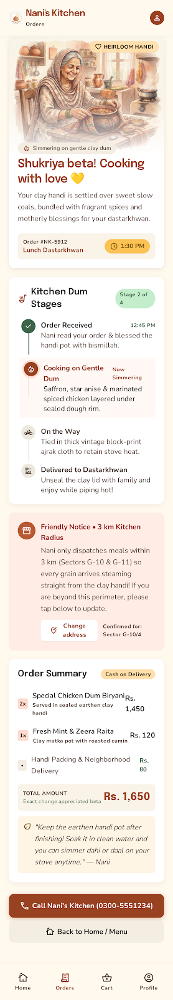
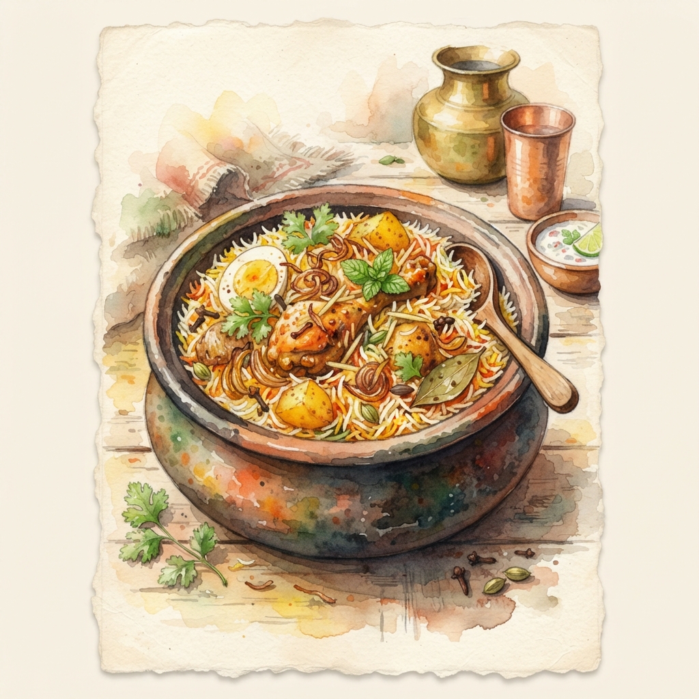
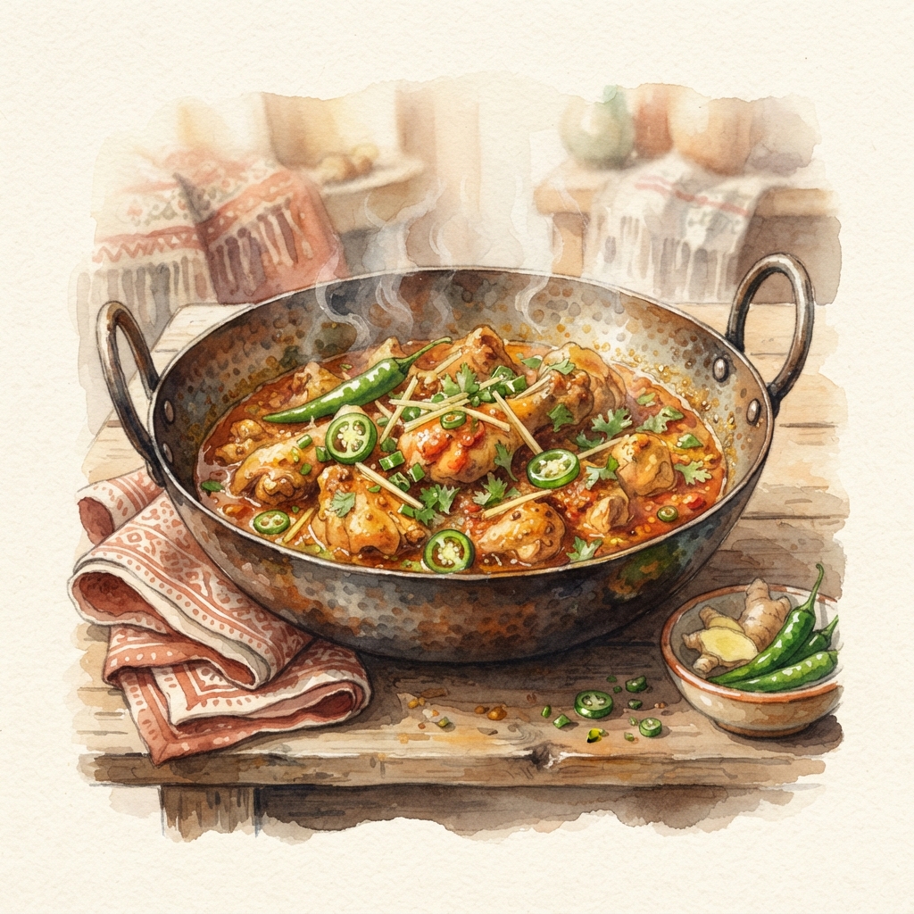
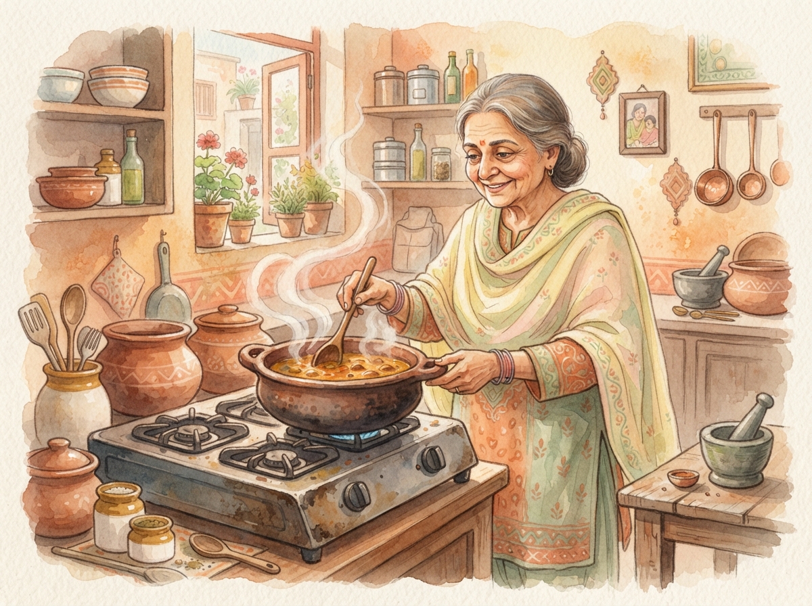
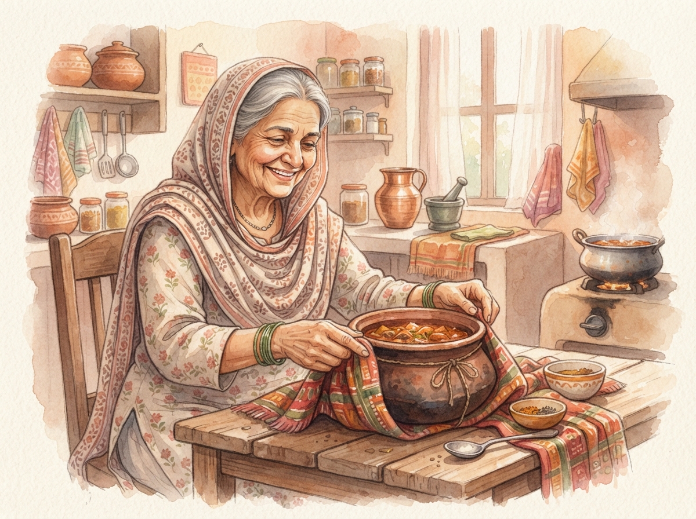

# Nani's Kitchen - Food Ordering App

A homemade Pakistani food ordering app with a mood-based menu, voice ordering in Urdu or English, and a live "handi" order tracker, all illustrated in a warm hand-painted watercolour storybook style.

Designed with **Google Stitch**. Each screen folder has the exported `code.html` (open it in a browser) and a `screen.png` preview.

## Screens

| Home | Voice Order | Order Confirmed |
|---|---|---|
|  |  |  |
| [View code](screens/home/code.html) | [View code](screens/voice_order/code.html) | [View code](screens/order_confirmed/code.html) |

## Illustrations

| | |
|---|---|
|  |  |
|  |  |

## Design System

- [Dadi's Kitchen Recipe Journal](design-systems/dadis_kitchen_recipe_journal.md) - colours, fonts and style rules
