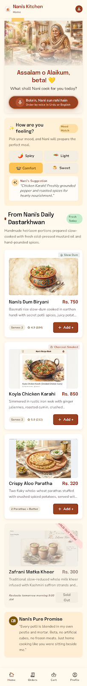
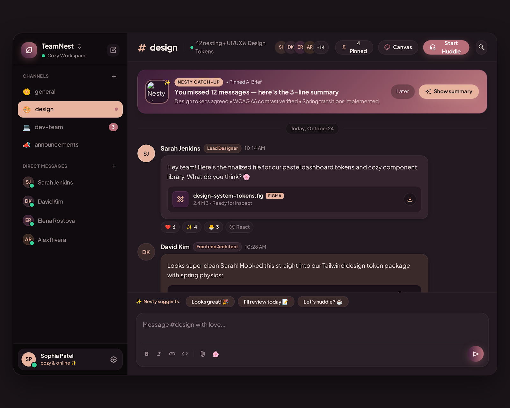

# Stitch UI Designs

UI/UX design projects created with **Google Stitch** for the Algorithm internship (Phase 01).

| Nani's Kitchen | TeamNest |
|---|---|
|  |  |

## [Nani's Kitchen - Food Ordering App](Nanis-Kitchen-Ordering-App/)

A homemade Pakistani food ordering app with a mood-based menu, voice ordering in Urdu or English and a live order tracker, illustrated in a warm hand-painted watercolour style.

**3 screens + 4 illustrations** - [see all screens](Nanis-Kitchen-Ordering-App/README.md)

## [TeamNest - Team Messaging Web App](TeamNest-Team-Messaging/)

A cosy team chat workspace in a dark black plum and rose-gold theme, with "Nesty", an AI copilot that summarises missed messages and suggests replies.

**2 screens** - [see all screens](TeamNest-Team-Messaging/README.md)

## Folder structure

```
<Project>/
  screens/<screen-name>/code.html   - exported HTML
  screens/<screen-name>/screen.png  - screenshot
  images/                           - illustrations
  design-systems/*.md               - colours, fonts and style rules
```

**Author:** Asma Kanwal
