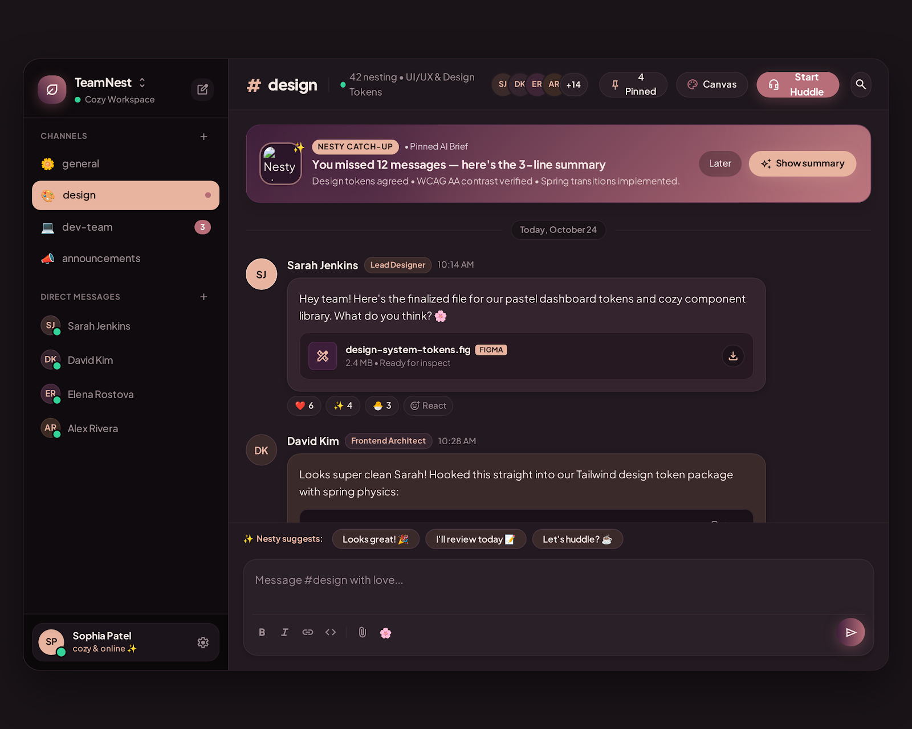
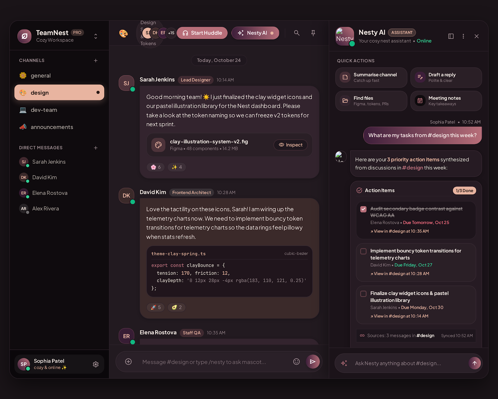

# TeamNest - Team Messaging Web App

A cosy team chat workspace with channels, file sharing and **Nesty**, an AI copilot that turns channel discussions into action items, summarises missed messages and suggests replies. Styled with the dark **Obsidian Rose** design system (black plum and rose gold).

Designed with **Google Stitch**. Each screen folder has the exported `code.html` (open it in a browser) and a `screen.png` preview.

## Screens

### Black Plum & Rose Gold Workspace - #design channel

[View code](screens/black_plum_rose_gold_workspace/code.html)

### Nesty AI Assistant Panel

[View code](screens/nesty_ai_panel_dark_plum/code.html)

## Design System

- [Obsidian Rose](design-systems/obsidian_rose.md) - colours, fonts and style rules
